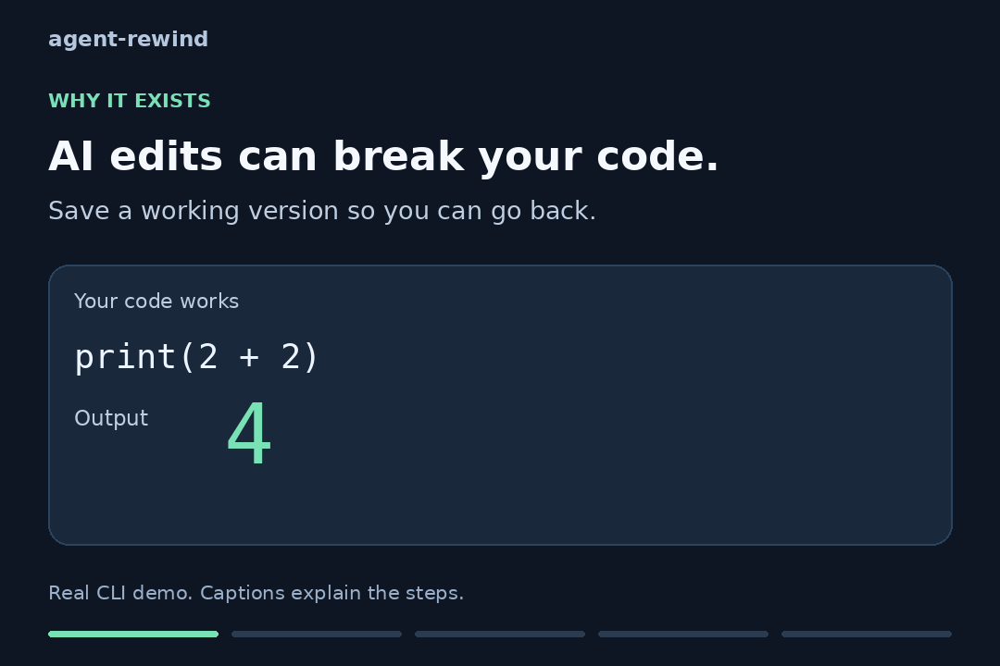
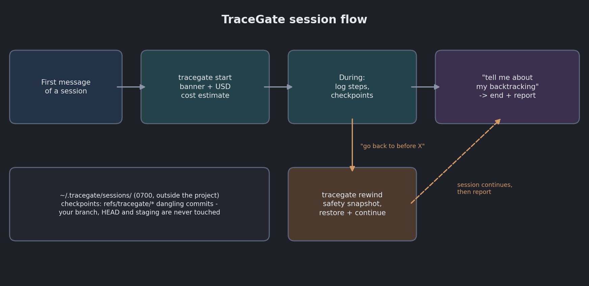
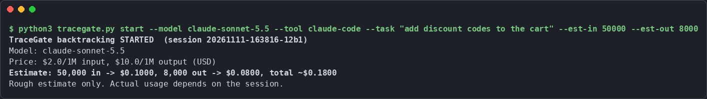
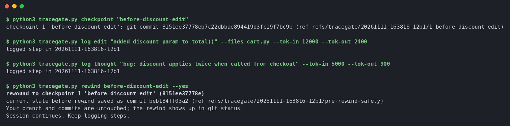
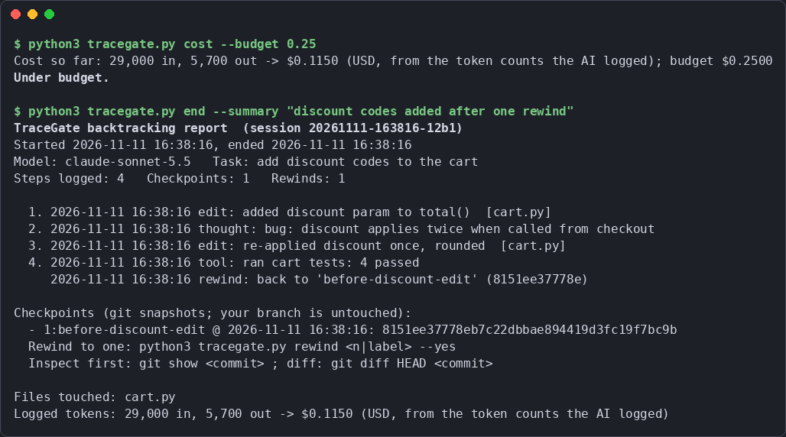

# TraceGate

[](LICENSE)
[](https://github.com/A2wkiller/agent-rewind/actions/workflows/tests.yml)



*Real CLI output in a disposable git repo. This shows the helper, not hooks firing inside a live AI coding tool.*

A plug-and-play skill for AI coding tools (Claude Code, Codex, Gemini CLI, Antigravity, OpenCode). It gives your session **real backtracking**: the AI logs what it does, snapshots your project at checkpoints, and can **rewind the project to a checkpoint and continue** when something goes wrong. It also gives you a rough USD cost estimate at the start of the session.

No API keys. No `.env`. No provider API calls. No network. Python 3 standard library only.



## What it does

1. **Session start:** with the installed hooks (Claude Code, Codex, Gemini CLI, Antigravity) the session starts by itself: the hook runs the helper and the AI sees the "TraceGate backtracking has started" banner in its context, with a rough cost estimate from the model's real price per 1M tokens in [`pricing.json`](skills/tracegate/pricing.json) (actual provider prices, checked 2026-11-11, sources inside). Raw USD, no currency conversion.
2. **During the session:** steps are logged, edits are auto-logged by hook where supported, and **risky shell commands (`rm -rf`, `git reset --hard`, `DROP TABLE`, ...) are auto-checkpointed before they run**. Checkpoints are git snapshots that never commit on your branch or touch your staging area.
3. **"Go back to before X":** `rewind` takes a safety snapshot, restores the project to the checkpoint, and the session continues. `branch`/`switch` let you keep two approaches and move between them.
4. **"Tell me about my backtracking":** the report shows steps, files touched, checkpoints **with the token cost at each one**, branches, rewinds, and total cost. On Claude Code and Codex the cost is **measured from the tool's own transcript files**, not the AI's guess.

Session logs live in `~/.tracegate/sessions/<project>/`, outside your project, one open session per project (keyed by git root).

## Real runs

These are captures of the actual script running (a demo project, a real git repo). No mock-ups.

**Session start with cost estimate:**



**Checkpoint, then rewind after the AI went wrong:**



**End-of-session report ("tell me about my backtracking"):**



## Install

One line (needs git and python3):

```bash
curl -fsSL https://raw.githubusercontent.com/A2wkiller/agent-rewind/main/install.sh | sh -s -- claude-code
# or: codex | gemini-cli | antigravity | opencode
```

The one-liner needs a POSIX shell (macOS, Linux, WSL or Git Bash). On plain Windows, clone and run the installer with `python` instead:

```powershell
git clone https://github.com/A2wkiller/agent-rewind.git
cd agent-rewind
python skills\tracegate\install.py claude-code
```

Or from a clone:

```bash
git clone https://github.com/A2wkiller/agent-rewind.git
cd agent-rewind
python3 skills/tracegate/install.py claude-code
```

The installer copies the skill and wires the tool's real lifecycle hooks (merged into the tool's config, existing settings kept, a backup saved first, `--no-hooks` to skip). What goes where:

| Tool | Skill folder | Hook config | Events wired |
| --- | --- | --- | --- |
| Claude Code | `~/.claude/skills` | `~/.claude/settings.json` | SessionStart, PreToolUse, PostToolUse, SessionEnd |
| Codex | `~/.codex/skills` | `~/.codex/hooks.json` | SessionStart, PreToolUse, PostToolUse, SessionEnd |
| Gemini CLI | `~/.gemini/skills` | `~/.gemini/settings.json` | SessionStart, BeforeTool, AfterTool, SessionEnd |
| Antigravity | `~/.gemini/antigravity/skills` | `~/.gemini/config/hooks.json` | SessionStart, PreToolUse, PostToolUse, Stop |
| OpenCode | `~/.config/opencode/skills` | none (no shell hooks exist, only JS plugins) | skill only |

Codex asks you to trust new hooks on first run (the `/hooks` menu); they do not run until you trust them. That is Codex's design. Hook contracts were verified against the tools' docs on 2026-11-11: [Claude Code](https://code.claude.com/docs/en/hooks), [Gemini CLI](https://geminicli.com/docs/hooks/), [Antigravity](https://antigravity.google/docs/hooks/), [Codex](https://learn.chatgpt.com/docs/hooks).

`--always-on` additionally appends one line to the tool's global instruction file as a fallback.

Prices: `skills/tracegate/pricing.json` ships real provider prices checked 2026-11-11 with their sources. Prices change (two Gemini entries are promos that expire 2026-11-30 / 2026-12-31), so verify against the linked provider pages if your estimate matters.

## Commands

| Command | What it does |
| --- | --- |
| `start` | Open (or resume) this project's session, print the banner and USD estimate. `--new` forces a fresh session |
| `log <thought\|tool\|edit\|note>` | Record one step, optional `--files`, `--tok-in/--tok-out` |
| `checkpoint "<label>"` | Git snapshot under `refs/tracegate/`, branch and staging untouched. `--full` includes git-ignored files |
| `rewind <n\|label> [--yes]` | Restore project files to a checkpoint (safety snapshot first), continue the session. `--delete-new` also removes files created after the checkpoint, only with `--yes` |
| `branch <name>` / `switch <name> [--yes]` | Keep the current state under a name; restore it later (safety snapshot first) |
| `cost [--budget USD]` | Token cost so far (measured from the tool transcript where possible); exit 1 when over budget |
| `tokens` | Measured usage from the tool's own transcript (Claude Code and Codex only) |
| `clean [--older-than N] [--yes]` | Prune session logs older than 30 days and `refs/tracegate/*` refs; prints the plan first |
| `end --summary "..."` | Close the session, print the report |
| `report` | Print the report again (default: latest session for this project) |
| `hook <event>` | Entry point the tools' hooks call; installed by `install.py` |

## Tests

```bash
python3 -m unittest discover -s tests -v
```

55 real tests, standard library only: estimate math, pricing lookup, checkpoint isolation from your staging area, full snapshots of ignored files, rewind restore and safety snapshot, delete-new confirmation, branch/switch, per-checkpoint cost, per-project sessions, cleanup, measured-token parsing (dedupe for Claude, cumulative for Codex), hook I/O contracts for all four tools, installer hook merging, and the one-line installer. They run the actual scripts in temp directories with real git repos. CI runs them on Linux and Windows (ubuntu-latest and windows-latest), Python 3.11 and 3.13.

## Honest status

What was actually run (Linux and Windows, Python 3.11 and 3.13, real git repos - CI on ubuntu-latest and windows-latest):

- the full test suite above, green on both operating systems
- the installer for all five targets, including hook config merging, `--always-on`, and re-running it
- the hook entry points with each tool's documented payload shape (stdin JSON in, the documented stdout shape out)
- scripted demo sessions (the captures above), including real rewinds that restored files, a full snapshot that restored a `.env`, a branch-and-switch round trip, and the measured-token parsers against real-format transcript fixtures

What was NOT tested, and you should check on your real tools:

- End-to-end hook firing inside the real tools. The hook configs and payload shapes follow each tool's current docs (links above), but no hook was observed firing inside a live Claude Code / Codex / Gemini CLI / Antigravity session. Codex additionally requires you to trust the hooks first.
- Whether each tool picks up the skill from the folder the installer uses. If one is wrong, use `--dest` or paste the SKILL.md into that tool's instruction file.
- Measured tokens exist only where the tool writes a readable usage file: Claude Code (`~/.claude/projects/*/`, verified format) and Codex (`~/.codex/sessions/`, verified format). Gemini CLI, Antigravity and OpenCode expose no verified local usage file, so their cost stays an AI-logged estimate and `tokens` says so.
- Auto-checkpoint risky-command matching is a pattern list in the helper; it catches the common wreckers and can miss exotic ones.

## Security

See [SECURITY.md](SECURITY.md): how to report a vulnerability (private vulnerability reporting is enabled), what the script does on your machine, and the one rule that matters - never log secrets.

## Contributing

See [CONTRIBUTING.md](CONTRIBUTING.md). Issues and PRs welcome.

## License

MIT - see [LICENSE](LICENSE).
